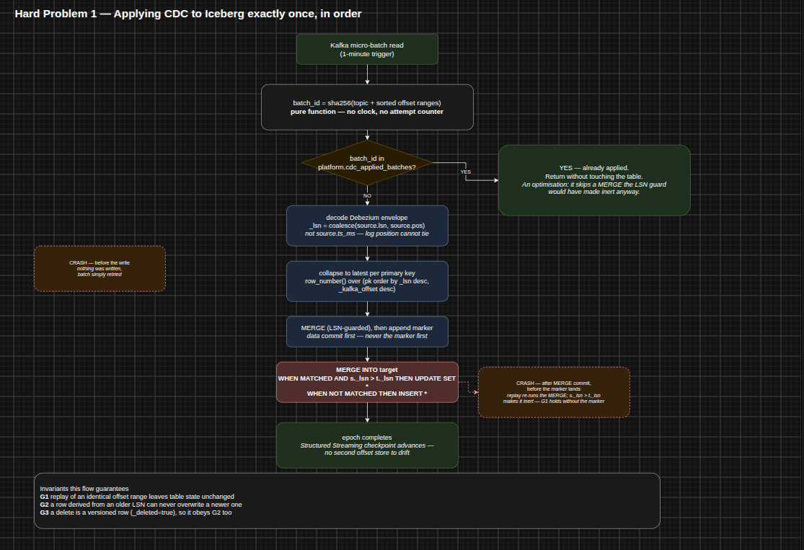
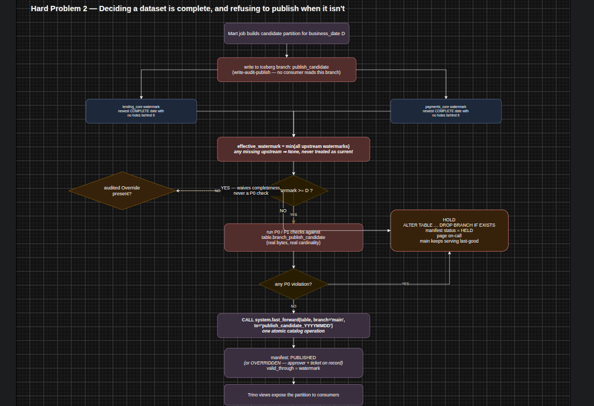
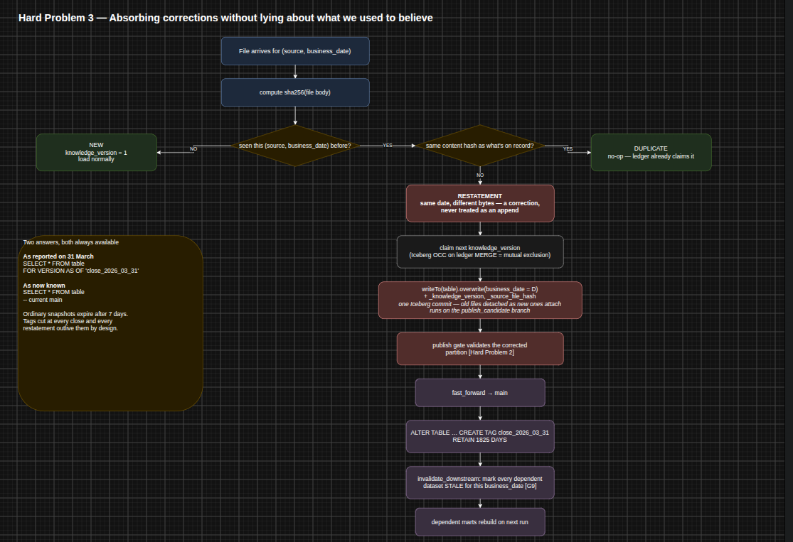

# Lakehouse Platform — Lending, Insurance and Recharge

Three businesses, each with its own OLTP systems, event streams, partner files,
third-party APIs and hand-maintained spreadsheets. That is a normal way for a company
to arrive at the stated symptom: nobody can say with confidence whether a given table is
current or correct. Everything here is in service of making that sentence false.

"Current or correct" reads as two separable and separately hard questions. *Correct* is
the transformation being right — same raw fact in, same number out, deterministically.
*Current* is honesty about time: the platform knowing what it does not yet know, and
saying so, rather than publishing a plausible number built on an incomplete input. A
design that solves correctness but not currency produces wrong answers with total
confidence, which is worse than the status quo, because the status quo at least makes
people suspicious.

None of the three hard problems is about volume. 10k events/sec is roughly 5 MB/s. They
are trust problems that happen to occur at a size where you cannot fix them by hand.

## Stack

| Component | Choice | What it buys here |
|---|---|---|
| Table format | Apache Iceberg on S3/Parquet | Branches and tags are first-class — the publish gate and the audit trail both lean on them directly |
| Catalog | Iceberg REST catalog (Polaris / Nessie) | The interface Iceberg defines, so every engine speaks it without a vendor bridge |
| Processing | Spark — batch and Structured Streaming | One engine for both; nothing downstream needs sub-second freshness |
| Query / serving | Trino for analysts, a KV store for applications | Four consumers want genuinely different shapes; one API over one table would serve all four badly |
| Orchestration | Dagster, partition-aware assets | The real scheduling condition is "has business date D arrived", not "is it 2am" |

Section 2 of the design document carries the full chosen / rejected / what-it-costs table.

## Deliverables

| Deliverable | File |
|---|---|
| Design document | `Design_Document.docx` · `Design_Document.pdf` |
| Architecture diagram | `diagrams/hardproblem1.png`, `hardproblem2.png`, `hardproblem3.png` — one per hard problem, each embedded in context below |
| Code for the hard parts | `dataplatform/cdc_apply.py`, `publish_gate.py`, `restatement.py`, `sqlutil.py` |
| Test plan | `Test_Plan.docx` · `Test_Plan.pdf`, with real pytest in `tests/` |
| Honesty section | Section 9 of the design document |

The end-to-end platform architecture — six zones left to right over a platform-services
band — is described in section 2 of the design document; the diagrams here go one level
down, into the mechanism behind each hard problem.

## Repo map

```
.
├── README.md
├── requirements.txt
├── pytest.ini
├── conftest.py                 shared fixtures; live in-process Iceberg catalog
├── build_docs.py               regenerates the two documents from structured content
│
├── dataplatform/
│   ├── cdc_apply.py            hard problem 1 — CDC under replay
│   ├── publish_gate.py         hard problem 2 — completeness and the publish gate
│   ├── restatement.py          hard problem 3 — corrections and knowledge time
│   └── sqlutil.py              SQL literal/identifier safety
│
├── tests/
│   ├── test_cdc_replay_idempotency.py
│   ├── test_stalled_upstream_holds_publish.py
│   └── test_restatement_classification.py
│
├── diagrams/
│   ├── hardproblem1.png        CDC under replay
│   ├── hardproblem2.png        the publish gate
│   └── hardproblem3.png        restatement and knowledge time
│
├── Design_Document.docx / .pdf
└── Test_Plan.docx / .pdf
```

## The three hard problems

Each one was chosen because getting it wrong produces a failure that is invisible in
production: the table stays queryable, nothing pages, and the wrongness surfaces months
later when someone reconciles against a source. That is a far worse failure shape than a
job that crashes, and it is the shape the brief's own pain statement describes.

### 1. CDC applied exactly once, in the right order

`dataplatform/cdc_apply.py`



Reading a batch from Kafka and recording how far you have read are two writes to two
systems with no transaction spanning them. If the process dies between them, the batch is
re-applied — and whether that is harmless depends entirely on whether the apply is
idempotent.

Ordering is carried by the source database's own log position as `_lsn`, not
`source.ts_ms`: host clocks are not monotonic across a failover, and two changes in one
transaction can share a millisecond, so timestamps tie and a log position cannot. The
MERGE gates its update on `s._lsn > t._lsn`, and that single predicate is both the
ordering guarantee and the idempotency guarantee — a replayed batch whose rows are all at
or below the target's current `_lsn` matches no update and inserts nothing, whether the
replay is immediate or ten batches later. Deletes are soft, so a late stale insert for a
deleted key is rejected by the same comparison instead of resurrecting it.

The per-batch marker table is an **optimisation, not the guarantee**: it skips a MERGE
that would have been inert anyway. The tests prove correctness with it removed entirely.

### 2. Deciding a dataset is complete, and refusing to publish when it isn't

`dataplatform/publish_gate.py`



Completeness is not observable. You cannot know whether more data is coming for a
business date — only whether everything you were promised has arrived. And the resulting
failure is quiet in a specific way: if a mart joins a healthy loan feed against a stalled
repayment feed, the output is queryable, non-empty, internally consistent and wrong.
Loans genuinely appear to have no repayments, so no null check and no referential check
fires. The only thing that catches it is refusing to publish past the slowest input.

So completeness is declared per source in an arrival contract and decided against, never
inferred from the data. A dataset's effective watermark is the **minimum** across its
upstreams, and each upstream's own watermark is the newest date with **no holes behind
it** — a maximum across upstreams ignores the laggard, and a maximum within one upstream
ignores a missing day. A missing signal is treated as unknown, not as up to date.

Publication is write-audit-publish on Iceberg branches: the candidate goes to a
per-business-date branch no consumer reads, graded P0/P1 checks run against those exact
bytes, and only a clean run is fast-forwarded onto `main` in one atomic catalog call. A
failure drops the branch and records `HELD`; `main` keeps serving the last good state.
An `Override` can waive incompleteness, on the record, with an approver and a ticket — it
can never waive a P0.

Consumers see stale-but-correct, never fresh-but-wrong.

### 3. Absorbing a correction without lying about what we used to believe

`dataplatform/restatement.py`



A settlement file for the 3rd arrives on the 7th with different totals. Finance closed the
month on the 5th using the old numbers. An auditor asks why the closed report and the live
table disagree. Both answers have to remain available, and the difference has to be
explainable.

Every delivery is classified against the ingest ledger by **content hash, never
filename** — partners rename, re-zip and re-send constantly, and only the bytes are
evidence. Same bytes is a duplicate and a no-op; a new hash for a known date is a
correction, never an append, which is the default behaviour of every naive file loader and
the one that silently doubles a day's settlement totals.

An Iceberg table's snapshot history already *is* a knowledge-time axis — every commit
records what the platform believed at that instant, for free. There is no need to build
bitemporal versioning, only to stop discarding it and name the moments that matter.
Ordinary snapshots expire after 7 days; a tag is cut at every finance close and every
published restatement and retained for five years, so "as reported on 31 March" becomes
`VERSION AS OF 'close_2026_03_31'` — an ordinary SQL read an auditor can run themselves.
The same mechanism gives data scientists leakage-free training sets without a second
system.

The correction replaces the partition in one commit, goes through the gate like any other
candidate — a correction is not automatically an improvement — and only once it publishes
are the tag cut and downstream datasets marked stale.

## Running the tests

```bash
pip install -r requirements.txt
pytest
```

The suite runs against a live in-process Iceberg catalog — Spark `local[2]`, hadoop
catalog type, a temporary warehouse, the Iceberg runtime pinned in `conftest.py`. The
assertions are against real MERGE, real branch DDL and real `fast_forward` semantics
rather than mocks of them, which is the only way a test catches a wrong API rather than
just a wrong idea. A first run needs network access to Maven Central to resolve the
Iceberg runtime, or a pre-populated `~/.ivy2` cache.

To regenerate the two documents:

```bash
python3 build_docs.py
```

Nothing needs to run for review.

## Assumptions

- **Settlement cutover.** Lending and payments settle at 23:00 IST, not midnight, so
  `business_date` derives from that cutover rather than the calendar date. I do not have
  the real cutover times for insurance or recharge and did not invent them; the design
  differentiates those two on behaviour I *can* reason about — restatement tail, volume,
  latency tolerance.
- **Catalog.** An Iceberg REST catalog (Polaris or Nessie) rather than Hive Metastore — a
  greenfield choice on merits, and the component I expect to break first.
- **Latency.** Nothing downstream needs sub-second freshness, which is what justifies one
  engine instead of adding Flink. If a fraud use case later needs it, that decision gets
  revisited rather than tuned.
- **`due_after_close` of 6 hours** is a reasonable-sounding default, not something
  load-tested against real arrival patterns — almost certainly too generous for recharge
  and too tight for insurance.
- **Watermark contiguity** assumes every calendar date is owed by every source. A source
  idle at weekends would over-hold; `_expected_dates` is the named seam for a per-source
  business calendar.

## Code size

`dataplatform/` is 1,070 lines across four modules, about 544 of them executable once
docstrings and comments are stripped. The brief suggests 200–400, so this is over it, and
I would rather say that plainly than derive a number that makes it look compliant.

The overage is almost entirely prose, and it is deliberate. Each module header states the
guarantees that module owns, and the reasoning for a decision sits next to the line
implementing it rather than only in the design document — the argument for
`s._lsn > t._lsn`, or for marking a batch applied *after* the data commit rather than
before, belongs at those lines. The brief says it reads code as code, because that is
where a guarantee either holds or does not. Strip the prose and the mechanisms themselves
are compact; the prose is there because the mechanisms are the part worth defending.

Tests are a further 823 lines including fixtures.

## AI disclosure

I used AI to draft and iterate the code, tests and documents against a design I had
already decided on, to generate the draw.io XML from a layout I specified box by box, and
as an adversarial reviewer of my own first pass.

That review pass is where the substantive corrections came from, and they matter more than
anything I got right first time:

- **The batch marker was not the guarantee I had claimed it was.** It is mutable — later
  updates overwrite the column — so its absence proves nothing, and the lookup I had
  described as cheap would in fact have scanned the table, because a sha256 defeats the
  min/max statistics Iceberg uses to skip files. The LSN predicate was doing the real work
  all along. The marker is now explicitly an optimisation, and the tests are restructured
  to prove correctness with it removed.
- **My completeness watermark had the exact bug the gate exists to prevent.** Within each
  upstream it took `max(business_date) WHERE complete`, which ignores holes: a source
  reporting D-3 and D but never D-2 would have published a month-end close built on a
  missing day. It is now the newest date with an unbroken run behind it, with a test.
- **I wrote APIs that do not exist, and caught them by checking rather than trusting.** An
  `INSERT INTO … REPLACE WHERE` that reads naturally and is Delta Lake syntax Iceberg does
  not have, plus three `system.*` procedure calls for creating and dropping branches and
  tags — those are DDL in Iceberg. Every Iceberg API here was checked against the
  documentation rather than accepted from a draft. Exactly the failure mode of a
  fluent-sounding draft, and exactly what a reviewer who reads code as code will catch.

Problem selection, the mechanisms, and the framing are mine: which three problems to go
deep on, the min-not-max and no-holes-behind-it watermark rules, treating a missing signal
as unknown rather than optimistic, the LSN predicate as the guarantee with the marker
demoted, content-hash classification, tags-as-knowledge-time, the line that an override
waives completeness but never a P0, and the five-clocks framing that ties the three
together. Full detail in section 9 of the design document.

